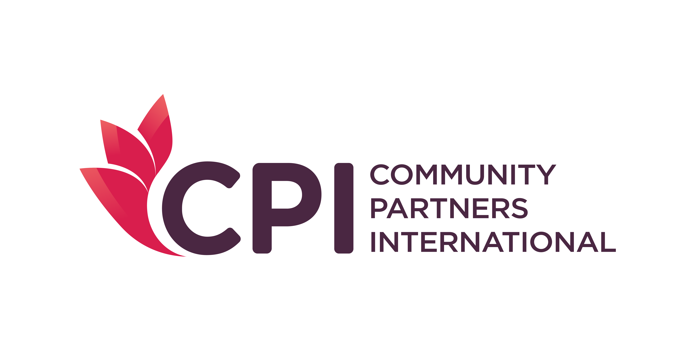

<!--
  Source copy for the cpintlORG organization profile README.
  GitHub renders an organization profile from the public repository
  cpintlORG/.github in the file profile/README.md.
  Copy this file and the assets/ directory there after review.
-->

  

<h1 align="center">cpintlORG</h1>

  <strong>Unofficial GitHub Organization of CPI</strong> 
  Maintainer-led · Not affiliated with or endorsed by Community Partners International

> [!IMPORTANT]
> **cpintlORG** is **not** the official GitHub organization of Community Partners International (CPI).
> It is not owned, operated, endorsed, sponsored, approved by, or affiliated with CPI, CPINTL, or any CPI entity.
> The `cpintlORG` GitHub organization and all its repositories are maintained by **Mohammad Ariful ISLAM** in a personal capacity and refer to him as the responsible maintainer.
> CPI names, logos, taglines and brand materials remain CPI property. Nothing here is an official CPI publication, statement or approval.

---

### Maintainer

**Mohammad Ariful ISLAM**  
Health Program Manager, Community Partners International (CPI), Bangladesh Mission

- Email: [healthbgd@cpintl.org](mailto:healthbgd@cpintl.org),
- GitHub: [healthbgd](https://github.com/healthbgd)

---

  For official purpose, please visit https://cpintl.org for further reference.

